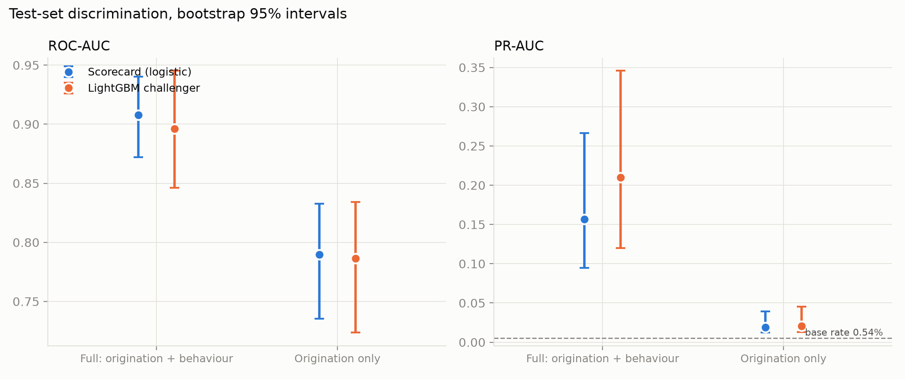
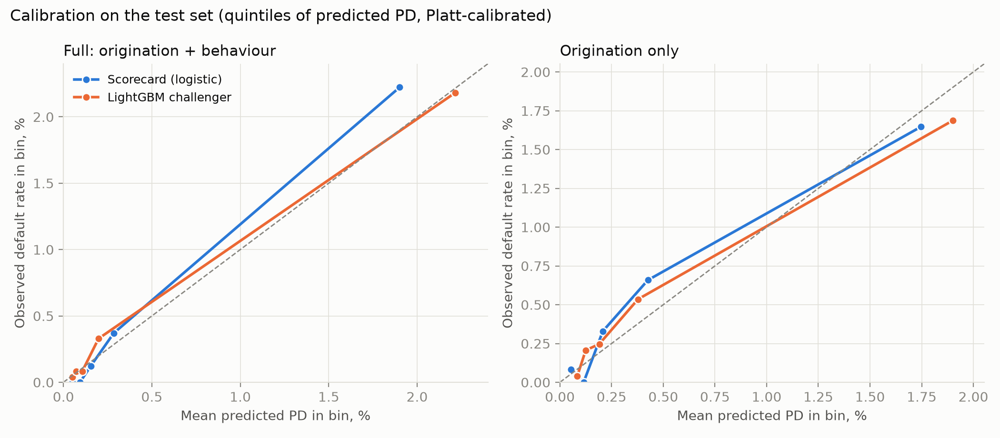
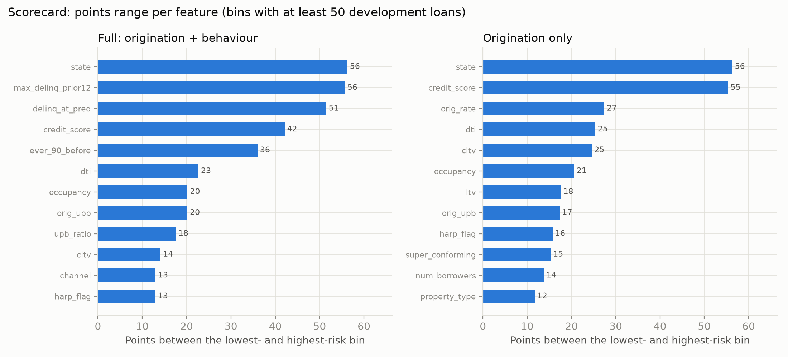
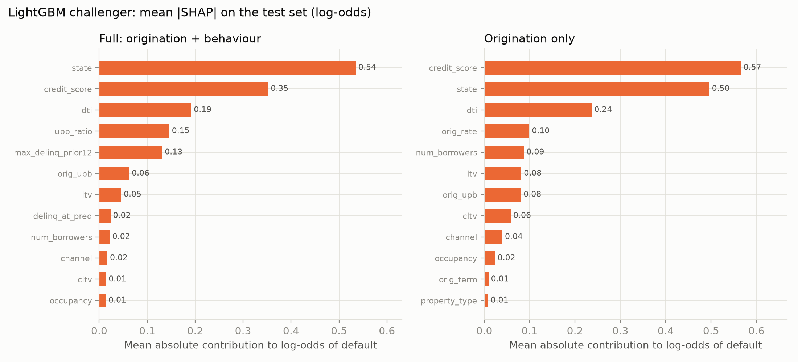
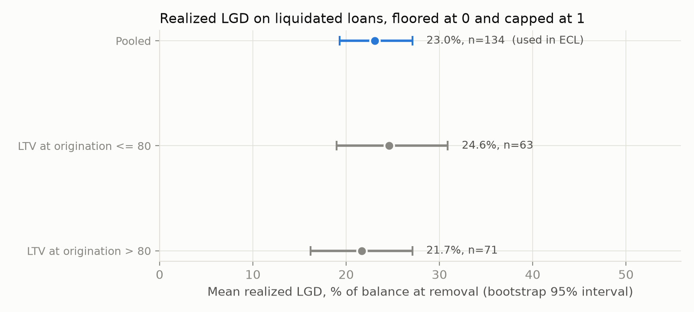
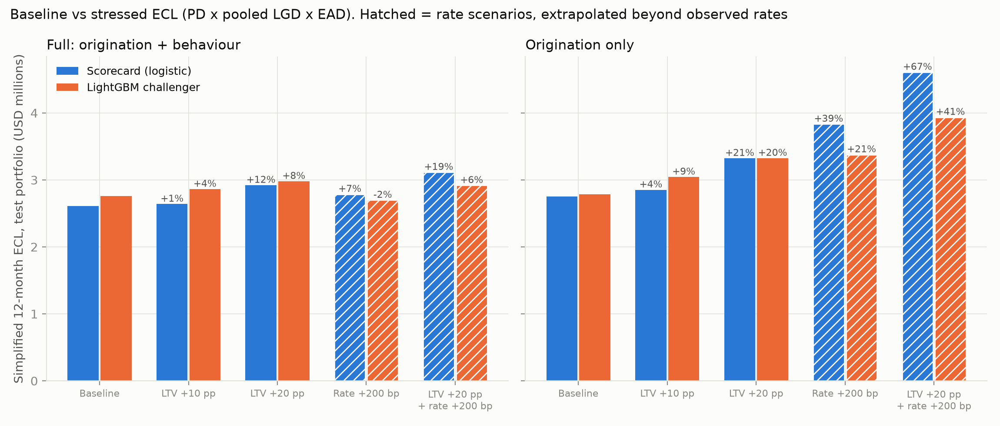
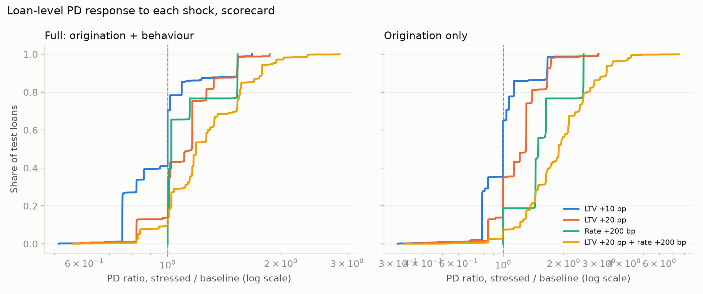

# Interpretable Credit-Risk Scorecard and Stress-Tested Expected Loss on a Single Mortgage Vintage

A reproducible 12-month default model, a simplified expected-loss estimate, and feature-shock sensitivity analysis, built on one vintage (2015) of Freddie Mac's Single-Family Loan-Level Dataset sample. This is a portfolio project: it is not a regulatory model, not IFRS 9, and not a forecast.

**Question:** for loans still performing at month 24 of a single vintage, which are most likely to hit a credit event in the next 12 months, what is a rough expected loss, and how sensitive is that loss to higher LTV and higher note rates?

## What was built
1. An interpretable logistic-regression scorecard (quantile-binned dummies, L2 regularization) for default within 12 months.
2. One challenger, LightGBM, compared on identical loans, split, and target.
3. A simplified 12-month expected loss, ECL = PD x LGD x EAD, with a pooled realized LGD from liquidated loans.
4. A feature-shock stress test: LTV +10 and +20 percentage points, note rate +200 bp, and a combined scenario, re-scored with every model.
5. An ablation: models with and without as-of-prediction behavioural features (delinquency history), because they change the story.

## Data
Freddie Mac Single-Family Loan-Level Dataset, **2015 sample file**: 50,000 fixed-rate loans (standard dataset), with monthly performance through March 2026. The data is not in this repository and must not be committed; download it from Freddie Mac's Clarity portal (free registration) into `data/raw/` and review Freddie Mac's terms before publishing derived results. The field layout comes from the dataset's General User Guide (Release 47); `configs/schema_map.yaml` records it, and `src/creditrisk/check_schema.py` verifies it against the files.

## Target design
- **Prediction point:** the 24th month after the first payment month, one row per loan. Chosen over ages 12 and 36 and fixed calendar dates because it gave the most events among rules whose outcome windows avoid the COVID period (see `docs/target_definition.md`).
- **Eligible:** a performance row exists, delinquency under 90 days, loan not terminated, balance above zero.
- **Default** in the next 12 months: 90+ days delinquent, REO acquisition, or a credit-event termination (zero balance codes 02, 03, 09, 15). Voluntary payoff is non-default; loans ending as code 16 or 96 in the window are excluded.
- **Features:** origination fields (19), plus five as-of-prediction fields (current balance ratio, delinquency status at month 24, worst delinquency in the prior 12 months, ever 90+ before, modification flag). Outcome fields are blocked by a schema-driven assertion and a test.
- **EAD:** current actual unpaid balance at the prediction month.

| Step | Loans |
|---|---|
| Sample file | 50,000 |
| After dropping first payment later than 2016-03 | 49,924 |
| With a performance row at age 24 | 41,003 |
| Eligible | 40,492 |
| Excluded (ended in window as code 16/96) | 1 |
| **Modeling population** | **40,491** |
| Defaults in window | 221 (0.55%) |
| Paid off inside the window (non-default) | 4,025 |

## Method
- **Split:** one loan-level stratified split, 70/30, seed 42: 28,343 development loans (155 defaults) and 12,148 test loans (66 defaults). With so few events, tuning and recalibration use 5-fold stratified cross-validation inside the development set instead of a fixed validation set.
- **Scorecard:** five quantile bins per numeric feature plus a missing bin, one-hot categoricals (levels under 1% grouped), L2 logistic regression with the penalty chosen by cross-validated log loss. Weight-of-evidence encoding was skipped in favour of binned dummies. Coefficient signs are checked in `reports/<set>/sign_check.csv`.
- **Challenger:** LightGBM, 300 trees, small grid over learning rate, leaves, minimum leaf size, and L2 penalty.
- **Imbalance:** no resampling or class weights; probabilities are Platt-recalibrated on out-of-fold development predictions, so test-set calibration is a fair check.
- **Metrics:** ROC-AUC, PR-AUC, Brier score, calibration slope, and recall within the top 10% of scores, each with a 500-resample bootstrap 95% interval over test loans. Accuracy is not reported because a model predicting no defaults would score above 99%.
- **LGD:** realized loss divided by balance at removal for credit-event terminations with a reported loss (134 loans), floored at 0 and capped at 1. A pooled mean is used.
- **ECL variants:** `spec` = PD x LGD x EAD treats every default as a liquidation (conservative); `adj` multiplies by the observed share of in-window defaults that later liquidated with a loss.
- **Stress:** `ltv` and `cltv` are shifted together (capped at 150), or note rate +2.0 points, then every loan is re-scored. Baseline PDs on the test set are asserted to reproduce the saved predictions.

## Results
All numbers below are from the held-out test set (12,148 loans, 66 defaults, base rate 0.54%). Full tables: `reports/summary_tables.md`.

### Discrimination and calibration
| Feature set | Model | ROC-AUC | PR-AUC | Recall, top 10% | Calibration slope |
|---|---|---|---|---|---|
| Full | Scorecard | 0.908 (0.872 to 0.940) | 0.157 (0.095 to 0.266) | 0.68 (0.56 to 0.80) | 1.03 (0.91 to 1.20) |
| Full | LightGBM | 0.896 (0.846 to 0.945) | 0.210 (0.120 to 0.346) | 0.77 (0.67 to 0.89) | 1.00 (0.88 to 1.16) |
| Origination only | Scorecard | 0.790 (0.736 to 0.833) | 0.019 (0.012 to 0.039) | 0.33 (0.22 to 0.44) | 0.78 (0.62 to 0.96) |
| Origination only | LightGBM | 0.786 (0.724 to 0.834) | 0.021 (0.013 to 0.045) | 0.38 (0.27 to 0.51) | 0.76 (0.61 to 0.92) |




- **No model wins.** The scorecard and LightGBM intervals overlap on every metric; with 66 test defaults the data cannot separate them. The interpretable scorecard is competitive.
- **Behaviour drives most of the signal.** Adding delinquency history at month 24 lifts ROC-AUC from about 0.79 to about 0.90. This is not leakage (all fields are observed at or before the prediction month) but it resembles roll-rate behaviour: loans already 30-89 days late are the ones that reach 90+.
- **The delinquency fields split the population sharply.** Because most loans have never been late, the binner collapses each field to two bins. In the development set, 809 loans (2.9%) had any delinquency in the prior 12 months and 9.64% of them defaulted, against 0.28% of the other 27,534. Loans already 30 to 89 days late at month 24 (213 loans) defaulted at 24.88% against 0.36%. Across the full modeling population, the 1,154 loans (2.9%) that were either late at month 24 or late at some point in the prior 12 months hold 115 of the 221 defaults (52%): a default rate of about 10% against about 0.27% for the other 39,337 loans. The scorecard gives the late groups about 52 to 56 fewer points than the never-late group, roughly 7 times the odds in the fitted model, far less than the raw ratios of about 40 to 90 times because the two fields overlap.
- **Origination-only models rank loans but give weak probabilities.** Their Brier score (0.0054) equals that of a constant prediction at the base rate, and the calibration slope is below 1 (predictions are over-dispersed).
- **Sensitivity to disaster-flagged events.** 65 of the 221 defaults carry a disaster flag and 119 a borrower assistance plan. Removing disaster-flagged test defaults changes ROC-AUC from 0.908 to 0.901 (full scorecard) and 0.896 to 0.884 (full LightGBM), but from 0.790 to 0.754 and 0.786 to 0.742 for the origination-only models, so their ranking depends more on those events.
- **State is largely a disaster-exposure proxy in this vintage.** In the development set, Florida accounts for 49 of 155 defaults (2.8% vs 0.55% overall); 52 of 54 states have fewer than 10 defaults. Across all 221 defaults, 100 are in FL, TX or LA (states chosen after seeing the data), and 62 of those carry a disaster flag, against 3 of 121 elsewhere. Removing `state` lowers the scorecard's test ROC-AUC (0.908 to 0.868 full; 0.790 to 0.760 origination-only, intervals on the difference exclude zero) but changes LightGBM's AUC and every PR-AUC within noise. The models were kept with `state` included; its contribution should be read as exposure to the 2017 hurricane season in these outcome windows, not as a stable geographic risk factor.

### What the models use



Scorecard points are on a 600-point scale (20 points to double the odds); the full table is in `reports/scorecard_points.md`. In the full model the widest points ranges are `state` (56), `max_delinq_prior12` (56), `delinq_at_pred` (51) and `credit_score` (42). For LightGBM, mean absolute SHAP on the test set ranks `state` (0.535), `credit_score` (0.352), `dti` (0.192), `upb_ratio` (0.146) and `max_delinq_prior12` (0.131) highest. The delinquency fields rank lower in SHAP than in the scorecard because mean |SHAP| averages over all loans and only about 3% are ever late; the points range measures the gap between bins instead. In the origination-only models, `credit_score` leads LightGBM (0.566) and `state` leads the scorecard (56 points, with `credit_score` at 55). The points range favors features with many levels, so read it alongside the SHAP ranking and the state check above.

### Realized LGD
Pooled mean **0.230** (95% bootstrap interval 0.193 to 0.271, n = 134; median 0.16). A split by origination LTV gave 0.217 (above 80, n = 71) and 0.246 (80 or below, n = 63): overlapping intervals and the opposite direction to expectation, so the segments were not used. A plausible reason, not tested, is mortgage-insurance recoveries on higher-LTV loans.



### Expected loss and stress (test portfolio, change in `spec` ECL vs baseline)
| Scenario | Full scorecard | Full LightGBM | Orig-only scorecard | Orig-only LightGBM |
|---|---|---|---|---|
| Baseline ECL, spec (USD M) | 2.611 | 2.756 | 2.753 | 2.783 |
| Baseline ECL, adj (USD M) | 0.343 | 0.362 | 0.361 | 0.365 |
| Expected defaults (66 observed) | 60.3 | 64.2 | 61.9 | 65.1 |
| LTV +10 pp | +1.1% | +3.9% | +3.6% | +9.4% |
| LTV +20 pp | +11.9% | +8.1% | +20.7% | +19.5% |
| Rate +200 bp | +6.7% | -2.1% | +39.3% | +21.4% |
| LTV +20 pp and rate +200 bp | +19.3% | +5.9% | +67.4% | +41.5% |




- LTV +20 pp raised simplified ECL by roughly 8% to 21% across the four models; LTV +10 pp by roughly 1% to 9%.
- **The rate scenario is not reliable.** Models disagree in sign and size, and 98% of loans end up above the 99th percentile of observed rates. In a single vintage the original rate mostly reflects risk-based pricing and origination timing, and for a fixed-rate loan a rate rise does not change the payment. Read it as "what if every loan looked like the highest-rate loans".
- LTV shocks also push 14% (+10 pp) and 25% (+20 pp) of loans beyond the 99th percentile of observed LTV, and scorecard bins make the response step-like.

## Limitations
- **One vintage, random split.** Results describe 2015 fixed-rate, full-documentation loans still performing at month 24, a survivor population. There is no out-of-time validation and no claim about other vintages, products, or economic conditions.
- **Few events.** 221 defaults (66 in test) give wide intervals. Differences between models are not statistically supported.
- **The default label is broad.** 90+ days delinquent includes spells that cured. Only 29 of 221 in-window defaults (13.1%, interval 9.3% to 18.2%) later ended in a liquidation with a reported loss, and many involved forbearance or other assistance.
- **LGD is simplified.** It is liquidation-only (134 loans over the whole life of the sample, including test loans), excludes modification costs, and applies one average to every loan. `ecl_spec` therefore overstates, and `ecl_adj` likely understates, economic loss; the truth lies between them.
- **Stress tests are sensitivities.** Changing a feature in a fitted model is neither a causal estimate nor a macroeconomic forecast. LTV is origination LTV, not a current house-price-indexed value, and large shocks extrapolate beyond the data.
- **Not IFRS 9.** No staging, lifetime PD, discounting, or forward-looking scenarios.
- **One coefficient sign fails the check.** `cltv` has a slightly negative association with its binned coefficient in both feature sets (Spearman -0.1 across five bins). It is nearly collinear with `ltv`, which carries the expected positive sign, so the pair is best read together; the scorecard was not adjusted.
- **Event concentration.** Roughly a third of development defaults are in Florida, and most disaster-flagged defaults sit in three Gulf states. Discrimination, and the stress results, partly reflect that single set of events, so they should not be expected to carry over to other vintages or years.

## Scope decisions and not done
Built after the core pipeline: a points-scaled scorecard table, LightGBM SHAP importance, and a state ablation (see `interpret.py` and `state_check.py`).

Left out on purpose, to keep the project finishable and the claims inside the evidence:
- **Survival or lifetime PD, IFRS 9 staging, discounting:** the target is a single 12-month default flag, so the expected loss is a simplified 12-month figure.
- **Multi-vintage or out-of-time validation:** one vintage and a random split. Adding vintages would be the most useful extension.
- **A full LGD model:** one pooled realized-loss average; an LTV split was tried and not used.
- **External macro data:** stress tests are feature shocks to fitted models, not macroeconomic scenarios.
- **Weight-of-evidence encoding, heavy hyperparameter tuning, MLflow, schema-validation libraries:** skipped as not needed at this scale; the leakage guard is a schema tag check plus a test.
- **COVID out-of-regime check:** the prediction rule was chosen so outcome windows avoid the COVID period; no separate COVID analysis was run.

## Reproduce

Create `data\raw\` and place the Freddie Mac sample files there (they are not included in the repository).

```
py -m venv .venv
.venv\Scripts\activate
pip install -r requirements.txt
py src\creditrisk\build_dataset.py
py src\creditrisk\train.py --features full
py src\creditrisk\train.py --features origination
py src\creditrisk\ecl_stress.py
py src\creditrisk\interpret.py
py src\creditrisk\state_check.py --features full
py src\creditrisk\state_check.py --features origination
py src\creditrisk\report.py
pytest -q
```
Seeds and decisions live in `configs/project.yaml`; five tests cover the binner, leakage guard, model-table integrity, and the split.

## Repository layout
```
configs/        project.yaml (seed, prediction rule, default definition), schema_map.yaml (field map)
docs/           field_dictionary_draft.md, target_definition.md
src/creditrisk/ inspect_files, check_schema, window_counts, build_dataset, features, train, ecl_stress, interpret, state_check, report
tests/          binner, leakage, table integrity, split tests
reports/        funnel, per-set metrics, scorecard points, SHAP importance, state checks, LGD and stress tables, figures, summary_tables.md
data/, artifacts/   not committed
```
